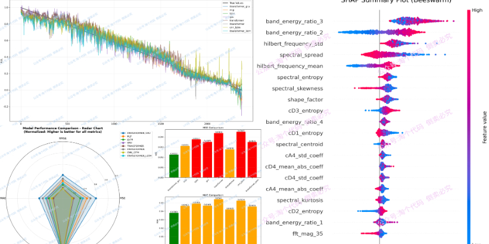

# Parallel iTransformer-GRU-SHAP Analysis of Bearing Life Prediction

In time series prediction, the iTransformer breaks through the limitations of traditional Transformers by cleverly designing "inverted dimensions," capturing both variable relationships and temporal dynamics simultaneously. To fully leverage its strengths, we innovatively built an iTransformer-GRU parallel network and applied it to the prediction of bearing lifespan. Notably, this article's tweet reveals key variables affecting bearing lifespan through SHAP interpretability analysis, making the predictions not only precise but also transparent and trustworthy.
This tweet is not merely about building a new network; it also provides a framework for deep learning bearing lifespan prediction based on SHAP, allowing you to easily add your own models for comparison and gain rich visualization graphics.
For more detailed information, please visit the following link:
Parallel iTransformer-GRU-SHAP analysis of bearing lifespan prediction is not just about the model itself, but also a framework for lifespan prediction comparison, which can be easily added with any comparative models.

## Images

<!-- PAYMENT_BLOCK -->

## Get this dataset

- Payment link (Stripe): [Buy now](https://buy.stripe.com/3cs8yP7sY87d0vu9AB)
- Payment QR code: 

<!-- /PAYMENT_BLOCK -->
